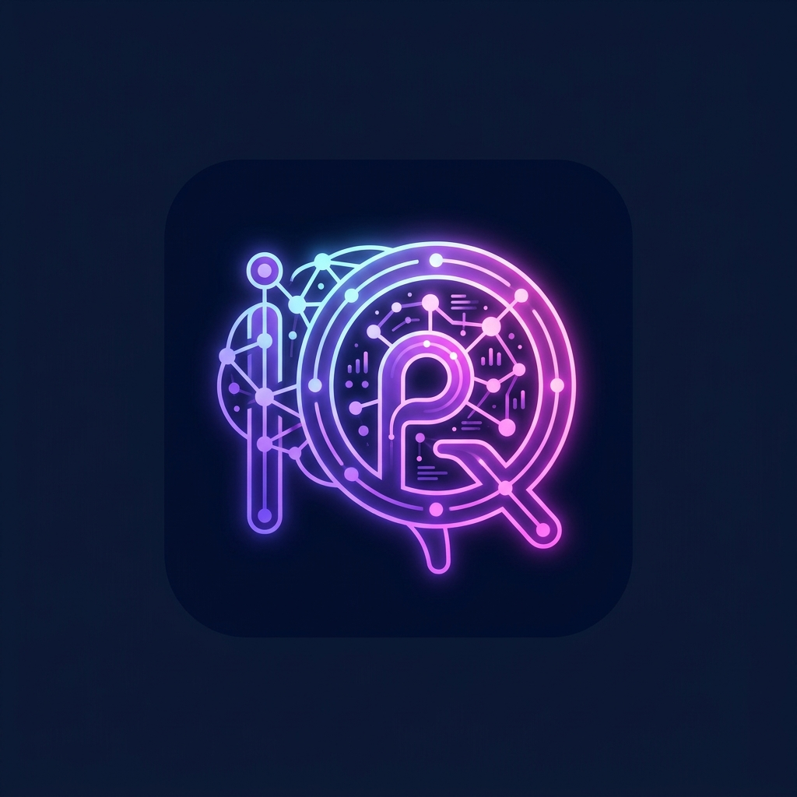

# PostIQ - AI Social Media Post Auditor (Android)

<p align="center">
  
</p>

<p align="center">
  <strong>Native Android AI Content Scoring, Cross-Platform Optimization & Continuous Calibration Engine</strong>
</p>

<p align="center">
  
  
  
  
  
</p>

---

## 🎨 UI Design Specification

- **Interactive UI Design Project**: [Google Stitch UI Design Link](https://stitch.google.com/projects/14598912411832818214)
- **Theme**: Cyber-Slate Dark Aesthetic (`#020617`, `#0F172A`, `#1E293B`) with radiant Neon Purple (`#A855F7`), Pink (`#EC4899`), and Cyan (`#06B6D4`) glowing accents.

---

## 📸 App Showcase

<p align="center">
  
</p>

---

## 🚀 Overview

**PostIQ** is an AI-powered social media post auditor that evaluates, scores, and refines content drafts across **7 major platforms** before publishing. Rather than generic advice, PostIQ analyzes algorithmic distribution mechanisms, calculates dimension scores, predicts organic reach, suggests first-frame hook architecture, redrafts copywriting, and adapts hashtags.

Furthermore, PostIQ features a **Continuous Calibration Loop** that uses **Pearson correlation** between past post audit scores and real-world performance metrics (views, likes, comments, shares, saves, watch time) to dynamically tune scoring multipliers specifically for your audience and niche.

---

## 📱 Key Features & Screen Breakdown

### 1. Dashboard & Audit History
- **Metric Highlights**: Displays active subscription tier, total audits completed, average quality score (0–100), and count of calibrated platform dimensions.
- **Search & Filter**: Search audits by title, caption, or niche with instant chip filtering by format (Video, Image, Carousel, Text).
- **Audit Cards**: Real-time score badges, platform pills, timestamps, and one-tap navigation to detailed platform audits or multi-platform comparisons.

### 2. Post Analyzer & URL Importer (`New Audit`)
- **Format Support**: Multi-modal inputs for Video / Reels / Shorts, Single Images, Carousels, and Text posts.
- **1-Click Social URL Importer**: Paste URLs from YouTube, TikTok, Instagram, LinkedIn, or X to automatically extract caption text, descriptions, hashtags, content type, platform metadata, and engagement numbers.
- **Niche Selector**: Tailored heuristics for Technology & SaaS, Finance & Investing, Fitness & Health, Education & Careers, Lifestyle, Comedy, and Cooking.
- **Platform Multi-Select**: Evaluate single platforms or up to 7 platforms simultaneously with custom audience/follower counts.
- **Live Post Logger**: Toggle to log real-time performance metrics (Views, Likes, Comments, Shares, Saves, Watch Time %) immediately upon creation.

### 3. Comprehensive Platform Report
- **Overall Score Gauge**: Circular gauge (0–100) paired with qualitative reach potential badges (*Very High Reach*, *High Reach*, *Moderate Reach*, *Low Reach*).
- **Audience & Distribution Modeling**: Computes realistic organic reach based on platform baseline algorithms, format bonuses, and follower counts.
- **Dimension Breakdown**: Progress indicators across Hook, Pacing, Captions, Hashtags, SEO Keywords, and Call-to-Action (CTA).
- **Actionable Findings**: Categorized by severity (*High Impact*, *Medium*, *Minor*) with diagnostic messages and specific implementation recommendations.
- **Platform-Adapted Copy & Hashtags**: 1-tap clipboard copying for algorithmic rewrites and optimized hashtag blocks.
- **Deep AI Algorithmic Audit**:
  - *Algorithmic Trend Analysis*: Current feed dynamics for your niche.
  - *Cold-Start Protocol*: Distribution strategy for accounts under 1,000 followers.
  - *First-Frame Hook Directives*: 3 hook patterns (Pattern Interrupt, Curiosity Gap, Contrarian Angle).
  - *Copywriting Redrafts*: Direct & Punchy vs Narrative Curiosity variants.
  - *Pacing & Audio Directives*: Optimal shot cut lengths and audio cues.
  - *Search & SEO Keywords*: 5 targeted keywords to rank in platform search.

### 4. Cross-Platform Comparison Scoreboard
- Side-by-side comparative cards evaluating each platform simultaneously.
- Highlights the **"Optimal Platform Fit"** (highest leverage channel).
- Direct drill-down to view deep audits for any platform.

### 5. Continuous Calibration Feedback Loop
- **Multipliers Tab**: Inspect real-time weight adjustments per platform and dimension (e.g., `hook` 1.25x, `seo` 1.15x, `cta` 0.90x).
- **Log Performance Tab**: Submit actual performance stats for previously audited content.
- **Trends Tab**: Track post scores against verified real-world views, likes, comments, and retention.

### 6. Subscription Tier Management
- **Free Starter ($0)**: Single platform per audit, heuristic scoring, core findings.
- **Creator Pro ($29/mo)**: All 7 platforms compared side-by-side, continuous calibration loop, audience seed modeling, deep AI feedback.
- **Agency Elite ($99/mo)**: Unlimited multi-platform audits, multi-niche calibrations, priority copywriting redrafts.
- 1-tap simulated tier switching directly in-app.

---

## 🎯 Supported Social Platforms

| Platform | Recommended Focus | Key Scoring Dimensions |
| :--- | :--- | :--- |
| **YouTube** | Shorts & Long-Form | Title SEO (15-60 chars), Description Keywords (>=20 words), 3-Second Hook, CTA, 3 Tags Max |
| **Instagram** | Reels, Carousels & Feed | First-Line Fold (<125 chars), Line Breaks, 5-10 Tiered Tags, Save/Share CTAs |
| **TikTok** | Short-Form & FYP | Screen Space (<150 chars), Loop Architecture, Fast Pacing (<2.2s cuts), FYP Tag Blend |
| **X / Twitter** | Posts & Threads | 280-char Thread Limits, Outbound Link Penalties, Minimal Hashtags (<=2) |
| **LinkedIn** | Articles & B2B Feed | Professional Tone (slang filter), No Hard Sales Words, Double Line Breaks, 3-4 Tags |
| **Facebook** | Reels & Page Feed | Contextual Hook (>=10 words), Community Share CTAs, Clean Formatting |
| **Threads** | Conversations | Text Brevity (<500 chars), Single Tag Focus, Discussion Prompts |

---

## 🛠️ Technical Stack

- **UI Framework**: Jetpack Compose with Material Design 3 (M3)
- **Programming Language**: Kotlin 2.2
- **Build System**: Gradle 9.3.1 (Kotlin DSL)
- **Android Gradle Plugin (AGP)**: 9.1.1
- **Target SDK**: 36 (Android 15+)
- **Minimum SDK**: 26 (Android 8.0 Oreo)
- **Architecture**: Model-View-ViewModel (MVVM) with StateFlow
- **Navigation**: State-driven Compose navigation with predictive `BackHandler` integration

---

## 🏗️ Building and Running the App

### Prerequisites
- Android Studio Ladybug / Meerkat (or newer)
- JDK 21
- Android SDK 36

### Build via Gradle
```bash
# Assemble Debug APK
gradle assembleDebug

# Output APK location:
# app/build/outputs/apk/debug/app-debug.apk
```

---

## 📦 Pushing to GitHub (`POSTIQ_NEW`)

### Option A: Via AI Studio Settings Menu (Recommended)
1. Open the project in Google AI Studio.
2. In the top-right header or project settings menu, select **Push to GitHub** or **Export to GitHub**.
3. When prompted, select or enter the repository name: **`POSTIQ_NEW`**.
4. Confirm to push all commits and project files directly to your GitHub repository.

### Option B: Via Local Git CLI
```bash
# 1. Initialize git and stage all files
git init
git add .
git commit -m "Initial commit: PostIQ Android app rewrite with complete Compose UI"

# 2. Rename branch to main
git branch -M main

# 3. Add your GitHub remote (replace YOUR_USERNAME)
git remote add origin https://github.com/YOUR_USERNAME/POSTIQ_NEW.git

# 4. Push to GitHub
git push -u origin main
```

---

## 📄 License

This project is licensed under the MIT License - see the LICENSE file for details.
